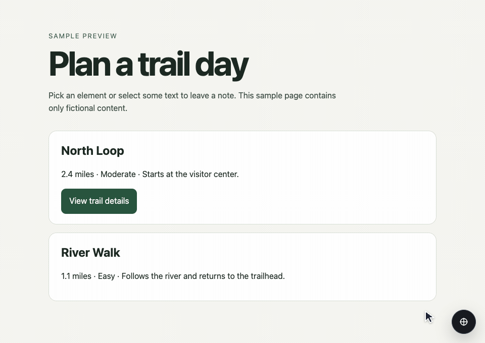

# UI Review Toolkit

Give someone a preview link and let them leave feedback **on the page itself**. Pin notes to elements, selected text, an area, or several elements. The builder can read the notes through the CLI or HTTP API, reply, and mark changes as fixed. Reviewers need no account.

UI Review Toolkit includes the browser overlay, a self-hosted FastAPI/PostgreSQL service, a CLI, and an [agent skill](skill/ui-review/SKILL.md). It works with websites you control and can add a script to.

## See it in action



Open the toolbar, select an element, save a note, then click its numbered pin to reopen it.

## Try it locally

You'll need Docker with Compose and Python 3. Run these commands from the repository root:

```sh
python3 scripts/init-config.py
docker compose up -d --build --wait
mkdir -p .review
(umask 077; set -C; docker compose exec -T api python -m app.cli create-token builder@example.test > .review/owner.json)
python3 scripts/review.py demo --output .review/demo-session.json
python3 -m http.server 8782 --bind 127.0.0.1 --directory .review/demo
```

With the demo server running, open the URL printed by this command in a private browser tab:

```sh
python3 scripts/review.py link .review/demo-session.json
```

Open the circular launcher, choose **Element**, select a trail card, and add a note. Open **Notes** to jump back to it. **Finish review** makes the review read-only; notes are saved as you go. See the saved feedback from the builder side:

```sh
python3 scripts/review.py list
python3 scripts/review.py show SESSION_ID
```

The demo works on your machine only. Stop its web server with Ctrl+C and stop the API and database with `docker compose down`. Saved notes live in the Compose database volume.

## Review your own preview

1. Put the API behind an HTTPS reverse proxy you control. Set `UI_REVIEW_PUBLIC_BASE_URL_REVIEW` in `.env` to its exact public origin, for example `https://review.example.com`, and recreate the API container. Keep PostgreSQL private. Read [deployment and security](SECURITY.md) before exposing the service.
2. Create a session for your trusted preview. Use `--api` before the subcommand, or set `UI_REVIEW_API`.

   ```sh
   python3 scripts/review.py --api https://review.example.com create \
     https://preview.example.com/design --title "Design review" \
     --output .review/design.json
   python3 scripts/review.py snippet .review/design.json
   ```

3. Add the printed snippet to the preview, ideally before `</body>`. For CSP, nonce or hash the small inline configuration script according to your policy; allow the exact API origin in `script-src` and `connect-src`. The snippet contains a session ID and asset URL and can be in preview source.
4. Open the generated reviewer link once to verify the actual page, then share it privately with the intended reviewer. The `link` command prints a **secret** link; keep it out of source, logs, and issues. Add `--ask-passcode` at creation if you want a separately shared passcode. Reviewer access defaults to up to 30 days. Remove the snippet when the preview graduates to production.

The overlay supports **E** for elements and **T** for text; Area, Multi-select, and desktop Layout are under **Advanced**. Pause freezes animations for inspection. Text suggestions can be previewed temporarily in the browser; they do not change the site's source. If a target moves or no longer matches, the note asks you to retarget it.

## Use it with a coding agent

Install [`skill/ui-review`](skill/ui-review) as a local skill in an agent that supports `SKILL.md` (for example, copy that directory into `~/.codex/skills/` or `~/.claude/skills/`). Give the agent the toolkit checkout path and the API origin. For an agent working on one review, mint a separate identity using `app.cli create-token` and pass its `userId` to `create --assigned-agent-id`. The assigned agent can read, reply, and update note state in that session. Keep the token in a private file and point the CLI at it with `--token-file`.

See the [HTTP API](docs/api.md) for revisions, grant revocation, and event cursors. Finish writes an event you can consume; the toolkit does not send email, Slack, or other notifications on its own.

## Develop

Use Node.js 22, Python 3.12, [uv](https://docs.astral.sh/uv/), and an **empty test PostgreSQL database**. Set `UI_REVIEW_DATABASE_URL` to the test database using a `postgresql+psycopg://` URL and generate a test-only `UI_REVIEW_GRANT_SIGNING_KEY` with `python3 -c 'import secrets; print(secrets.token_hex(32))'`. The app creates the schema on startup. Use a dedicated database for every toolkit instance; this release does not migrate data from another installation.

```sh
npm --prefix clients/ui-review ci --ignore-scripts
npm --prefix clients/ui-review run check:types
npm --prefix clients/ui-review run build:next
npm --prefix clients/ui-review test
uv run --locked --python 3.12 pytest -q
```

For the browser smoke test, start a fresh demo as above, install Chromium with `npx --prefix clients/ui-review playwright install chromium`, and run:

```sh
npm --prefix clients/ui-review run test:browser -- "$PWD/.review/demo-session.json"
```

This adds a synthetic note to the selected demo session. Run it only against the loopback demo.

## Credits and license

UI Review Toolkit grew out of Five Star Franchising's UI Review Next. [Agentation](https://github.com/benjitaylor/agentation) inspired the compact annotation workflow. This repository contains the toolkit's own implementation and is distributed under the [MIT License](LICENSE). Dependencies retain their own licenses.
